# How To Maximize GitHub

## How a reviewer reads your GitHub

A recruiter or hiring manager gives your GitHub about 30 seconds. They do three things, in this order:

1. Land on your **profile** and decide if you look like a real candidate for the role.
2. Glance at your **pinned projects** and pick the one that looks most like the job.
3. Open that project and read **the top of its README**. Most never scroll further or open your code.

So build your GitHub in that same order. This guide follows it.

**Quality beats quantity.** Two strong projects that look like the day-to-day work of your Job Target beat six thin ones. Start with one project and make it great before touching the next.

## Your path

Work through the levels in order. Do not start a level until the one before it is done.

| Level | What you build | Done when |
| --- | --- | --- |
| 1 | Profile basics | A stranger can tell your target role and how to contact you |
| 2 | One great project README | Your one-sentence summary passes the plain-language test and sits at the top with a result and a visual |
| 3 | Pinned projects | Your pins show only work you would be happy to discuss in an interview |
| 4 | Profile README | Your profile has a short welcome page that points to your best project |
| Final | Stranger test | Someone outside data can say what your project does and what you found after 30 seconds |

## Level 1: Profile basics

About 30 minutes. Your profile should match your LinkedIn.

- Add a clear picture
- Add a bio: your “sell yourself as a product” one-liner
- Add your job title and company name (or your target title)
- Add your LinkedIn or personal website link

**Done when:** a stranger can tell your target role and how to contact you without scrolling.

## Level 2: One great project README

Pick the one project that looks most like your Job Target’s day-to-day work. The README gives an in-depth description of your project so that other people, and your future self, can understand it. It is the first thing others use to judge your project, and often the only thing they read.

### Step 1: Write one plain sentence

Before any template, fill in this sentence:

```text
I used [data] to find out [question], and found [result],
which matters because [who cares and why].
```

Example (numbers are made up for illustration):

```text
I used 3 seasons of NBA salary data to find out which positions are
overpaid for their output, and found centers cost 22% more per win,
which matters because teams can rebalance their salary cap.
```

Rules: no jargon, no tool names, no model names. If you cannot write this sentence, you do not understand your project well enough yet. That gap is the thing to fix first, before any formatting.

### Step 2: Explain it out loud

1. Explain your project to someone who does not work in data, in 60 seconds. No screen.
2. Notice every place you stumble, go vague, or reach for jargon.
3. Go back to the project, figure out those parts, and rewrite your sentence in simpler words.
4. Repeat until the explanation flows.

This is also your answer to “tell me about a project” in interviews, so the practice counts twice.

### Step 3: Put the result and a visual at the top

The top of the README is what a reviewer sees before scrolling. It needs four things:

- A title that says what the project does
- Your one sentence from Step 1
- One visual: your best chart, a dashboard screenshot, or a diagram
- The result as a number where you can (see [How To Measure Impact](view.html?doc=m3-impact.md))

**Weak opening**

```markdown
# Project 2

This is my capstone project. I used Python, pandas, scikit-learn and
XGBoost. The notebook is in the notebooks folder. To run it, install
the requirements.
```

Why it fails: the title says nothing, there is no question and no result, and it leads with tools, which a reviewer cannot judge.

**Strong opening**

```markdown
# Which NBA positions are overpaid?

I used 3 seasons of NBA salary data to find which positions are
overpaid for their output. Centers cost 22% more per win than guards,
so a team could free up about $9M of salary cap by rebalancing.


Live dashboard · 3 minute video · How to run
```

Why it works: the title is the question, the result and its value come first, there is a visual, and the links let a busy reader go deeper only if they want to.

### Step 4: Fill in the rest

Below the opening, include:

- **Description:** what the project is, usage examples, issues or limitations, and future features
- **Technologies:** what you used, why you chose it, and installation instructions
- **How to run it:** an “Open in Colab” button ([openincolab.com](https://openincolab.com/)) is the easiest way
- **Dependencies:** run `pip freeze`, keep only the packages you used, and save them as `requirements.txt` in the repository
- **Folder structure** and a **flow diagram** if the project has several steps
- **Credits and license:** credit those who helped. See [choosealicense.com](https://choosealicense.com/) if you need help picking a license

Example `requirements.txt` file:

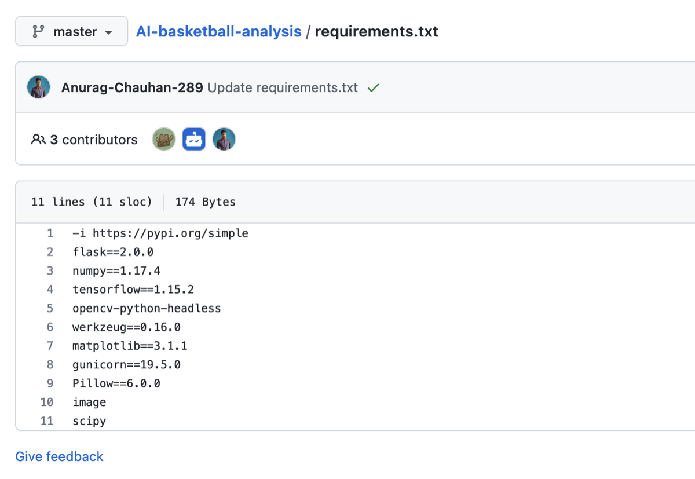

Tips for making it easier to read:

- Use a consistent format
- Add a table of contents if it is long
- Use images and GIFs. A picture is worth 1000 words
- A link to a short video presentation gives people another way in

Tips for specific roles:

- **Data Analyst** 👨‍💻👩‍💻: a short video explaining your project is a nice addition, though not needed for your first version
- **Data Scientist** 👨‍🔬🧑‍🔬: link a dashboard (for example Streamlit) so people can try your project without downloading files
- **Data Engineer** 👷👷‍♀️: a diagram of your pipeline is a must (see the example diagram below)
- **ML Engineer** 🤖: link a dashboard or demo, and show results with pictures

You should be able to explain every part of what you wrote: how the model works under the hood, what each metric means, and what each feature in your data is. If you cannot, go back to Step 2.

### Step 5: Clean up the repository

Small things reviewers notice in seconds:

- Give the repository a descriptive name, such as `nba-salary-analysis`, not `project2` or `capstone-final`
- Fill in the repository description and add topics (the gear icon next to “About”)
- Rename notebooks so none are called `Untitled.ipynb`, and number them in the order to read them
- Add a `.gitignore` so system and temporary files stay out
- Never commit passwords, API keys, or large raw data files
- Write commit messages that say what changed, not “update” or “fix”

### Examples of great READMEs

**Data Analyst:** [Pro Sports Salary Analysis](https://github.com/JP-Butler/Pro_Sports_Salary_Analysis)

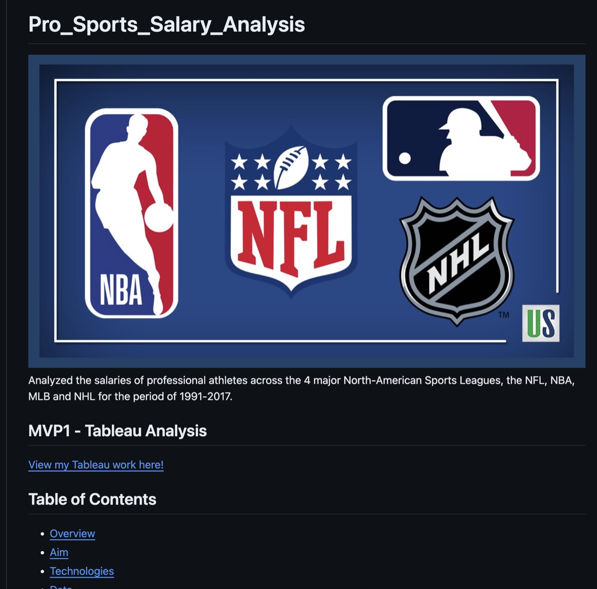

Why it works: a picture that represents the project, a one-line summary, a link to the Tableau work, and a linked table of contents.

**Data Scientist:** [African Finance Analysis](https://github.com/Davisy/Financial-Inclusion-in-Africa-App/blob/master/README.md?ref=hackernoon.com)

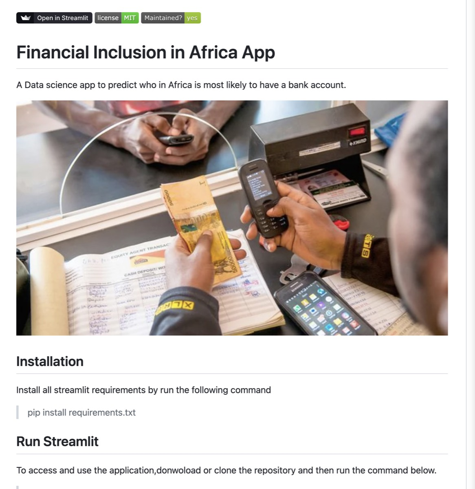

Why it works: one plain sentence says what it does, the picture draws you in, and the Streamlit link means nobody has to download the project.

**Data Engineer:** [Real-Time Violence Detection on AWS](https://github.com/Rahul-Vasan/Realtime-Violence-Detection)

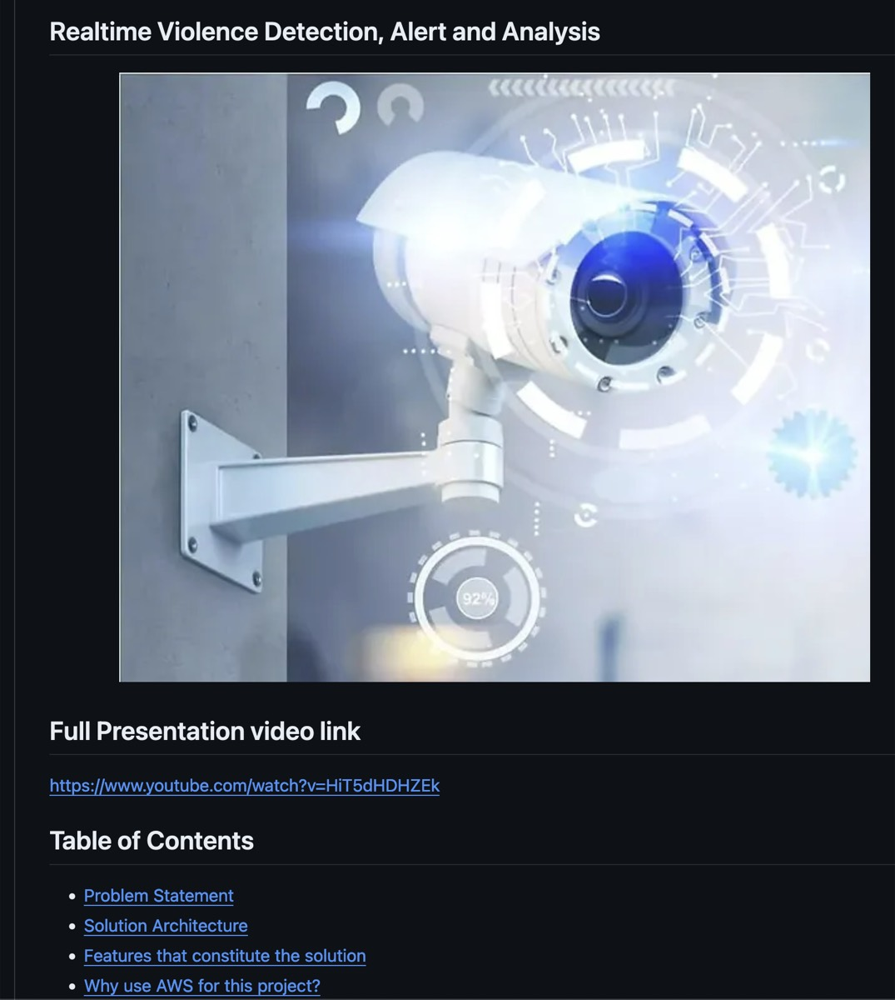

Why it works: picture, video and table of contents at the top, plus a diagram that makes the structure easy to understand:

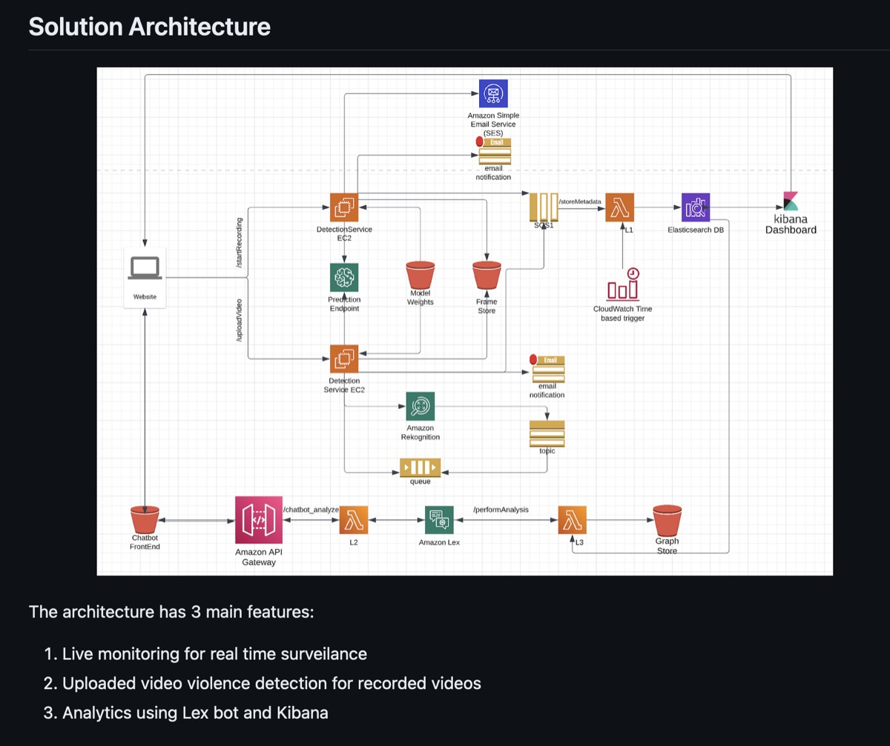

**ML Engineer:** [Energy Demand Remote Communities](https://github.com/JDandre/energy_demand_remote_communities)

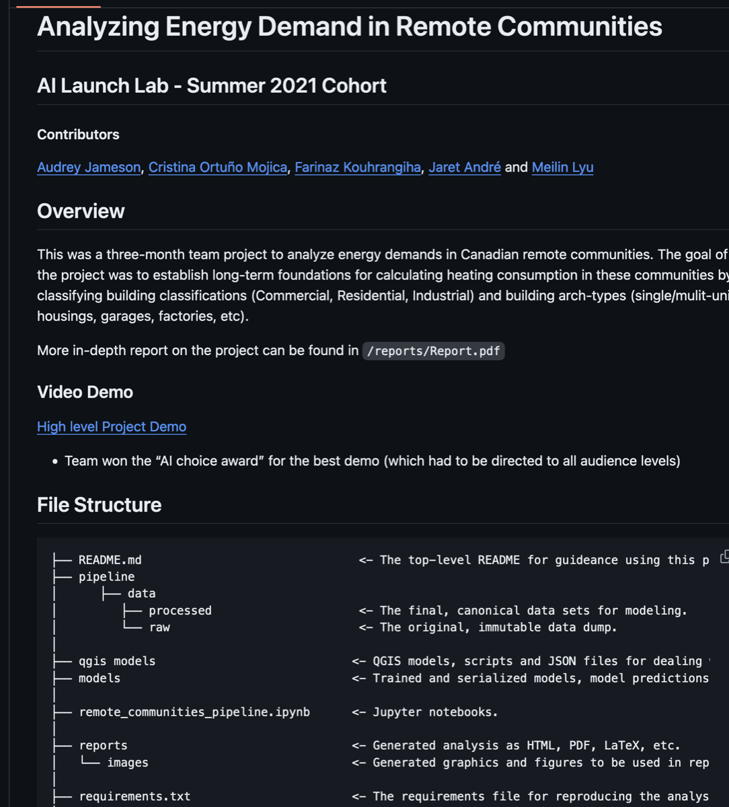

Why it works: a clear overview, a video demo, and a file structure that helps people navigate the repository.

Starting template: [Bonus: Readme Template](https://docs.google.com/document/d/1KKozb_yPAU-CKH_vW0ZCuoQIjKq2NZj6KexxHk3D8ww/edit?usp=sharing)

### Level 2 checklist

- Title says what the project does
- One plain sentence at the top, no jargon
- Result with a number, and one visual, before any scrolling
- How to run the project
- Dependencies in a `requirements.txt` file
- Folder structure, and a flow diagram if needed
- Repository name, description and topics filled in
- You can explain every part out loud

**Done when:** every box above is true for one project. Only then repeat Level 2 for a second project.

## Level 3: Pinned projects

- Pin only the projects you want others to see. You can pin up to 6, but 2 strong ones are better than 6 thin ones
- Put the project closest to your Job Target first
- Unpin course exercises and half-finished work
- Every pinned project needs a description and a README that has been through Level 2

The longer you have worked on a project, the better it looks, as it shows commitment, grit and determination.

**Done when:** you would be happy to discuss every pinned project in an interview.

## Level 4: Profile README

This is a welcome page at the top of your profile. Keep it short: who you are, your target role, and a link to your best project. Example: [SalaheddineAD (Salah Eddine Ait Daoud)](https://github.com/SalaheddineAD)

1. Press the “+” at the upper right of the page and then press “New repository”.

   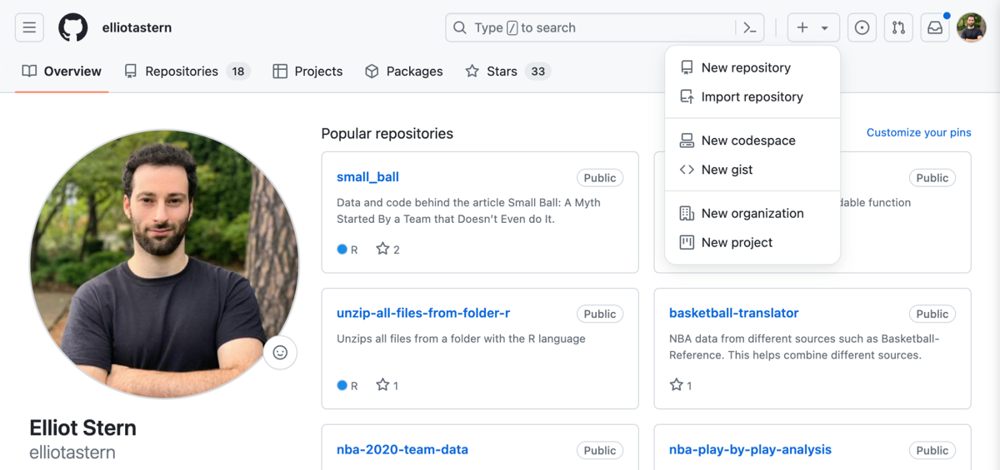

2. Name the repository your username. A box will appear saying this is a special repository for your GitHub profile.

   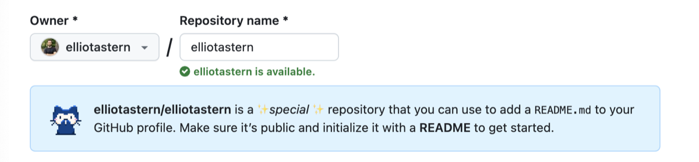

3. Check off “Add a README file”.

   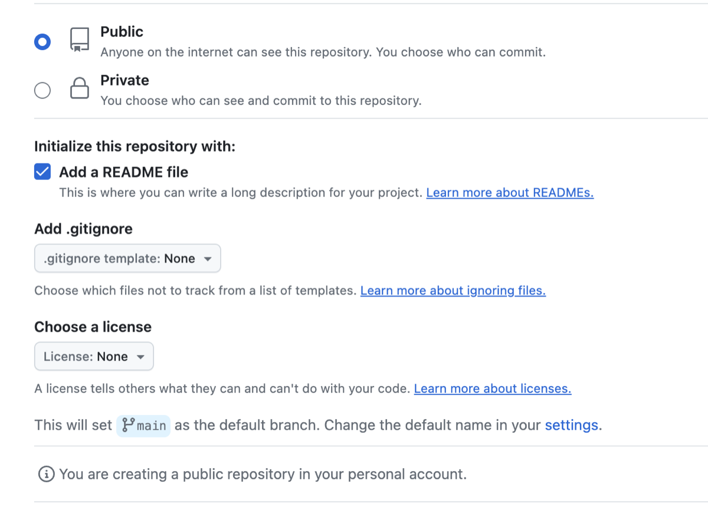

4. Press README.md on your new repository.

   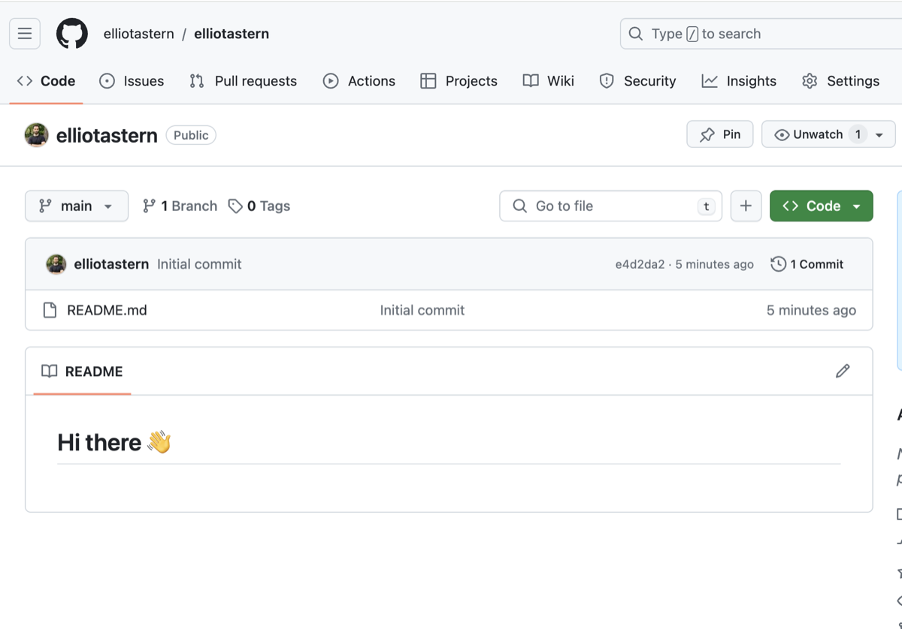

5. Paste in the template for your role, then edit your name, the languages you do and do not know, and other details:
   - [Data Analyst Readme](https://docs.google.com/document/d/1DxfQ7md92bb6LPmIQrXUmDPbdVWCvC5Lp6BeBOzKcZs/edit)
   - [Data Scientist Readme](https://docs.google.com/document/d/1MRihgjX_cU53Ld_jtiEBXkaPF-5GKGX9c3BbTlbYIYA/edit?usp=sharing)
   - [Data Engineer Readme](https://docs.google.com/document/d/1G2k9Ibn60hezhRZmJLGuLPg8D56pmq0jdij91ohU7FY/edit?usp=sharing)
   - [ML Engineer Readme](https://docs.google.com/document/d/1WlRdJ3LV1ouON03L9foJP7Scg6t41paYObARND7RtXg/edit?usp=sharing)
6. Toggle between “Code” and “Preview” to see how it looks and update as needed.

   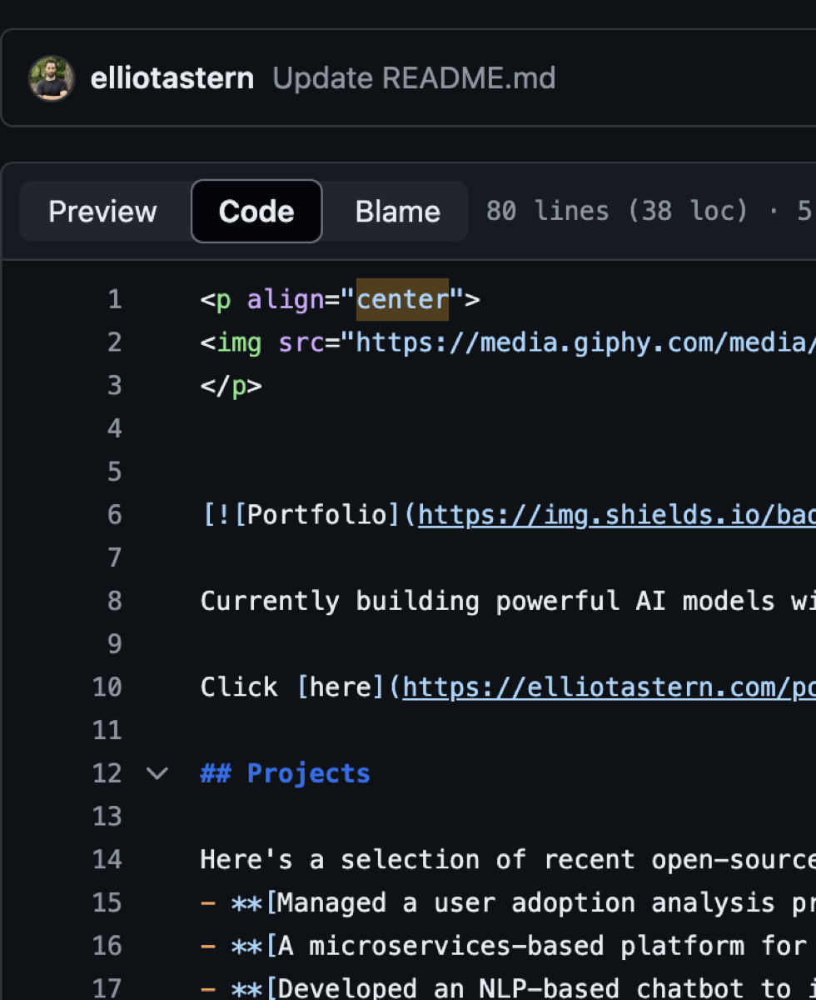

**Done when:** your profile opens with a short welcome that names your target role and links to your best project.

### Optional polish: badges, icons and animations

Only do this after Levels 1 to 4 are done. Decoration does not replace a clear project.

| Type | Looks like |
| --- | --- |
| About you badges |       |
| Coding badges |      |
| Tool icons |             |

Every badge follows one pattern. Swap the label, color and logo:

```markdown

```

Every icon follows one pattern. Swap the tool name:

```html

```

Copy ready-made code from these instead of writing it by hand:

- Badges: [markdown-badges](https://github.com/Ileriayo/markdown-badges)
- Icons: [devicon.dev](https://devicon.dev/)
- Animations: [Cool GIFs for GitHub](https://github.com/Anmol-Baranwal/Cool-GIFs-For-GitHub?tab=readme-ov-file). Add one with ``
- Stats cards: [github-readme-stats](https://github.com/anuraghazra/github-readme-stats)
- More profile inspiration: [creative-profile-readme](https://github.com/coderjojo/creative-profile-readme)

## Final check: the stranger test

1. Send your best project link to someone who does not work in data.
2. Give them 30 seconds with it. Do not explain anything.
3. Ask: “What does this project do, and what did I find?”

If they cannot answer both, the top of your README is not clear enough yet. Go back to Level 2, Step 1. This is the same test as the Module 3 item “one artifact a stranger can open and understand in about 6 seconds”.

## Takeaways

You should now have:

- A complete profile that matches your LinkedIn
- One or two projects that look like your Job Target’s day-to-day work, each with:
  - A plain one-sentence summary you can say out loud
  - A result and a visual at the top of the README
  - A clean, well-named repository
- Only your strongest projects pinned
- A short profile README
- A project that passes the stranger test

Next: [Maximize Portfolio (website)](view.html?doc=m3-portfolio.md)
